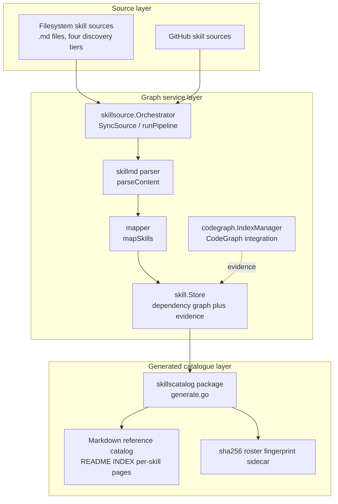
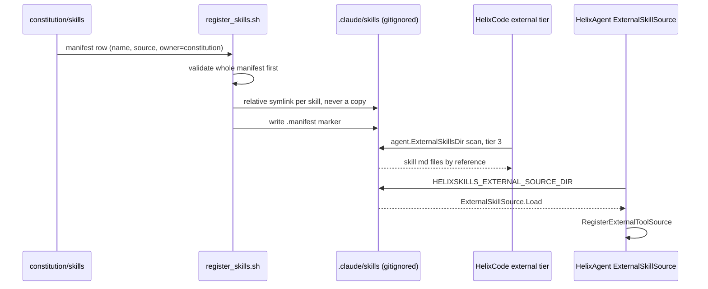
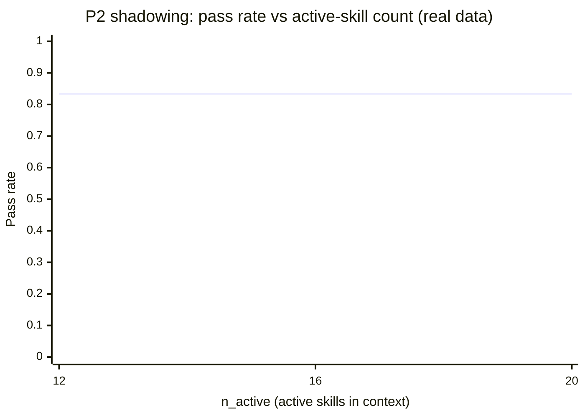
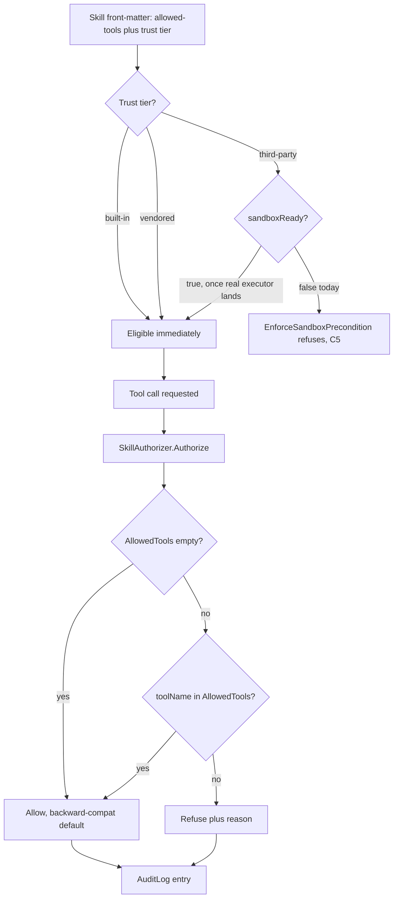

# HelixSkills incorporation — architecture &amp; diagrams (HXC-159 T-P8.03)

**Revision**: 1 · **Last modified**: 2026-09-23 · **Status**: current

Four diagrams covering the skills system this project incorporates (HXC-159
Phases P0–P9). A fifth diagram — the corrected Bridge layer-health map — lives
embedded in the Bridge design corpus itself
([`constitution/docs/research/extensions/speckit_superpowers/implementation/README.md`](../../../constitution/docs/research/extensions/speckit_superpowers/implementation/README.md#bridge-layer-health-b1-probe-result))
rather than duplicated here, since that is where a reader of the Bridge
corpus needs it (§11.4.258 — diagrams belong at their point of use, not in
an orphan gallery).

See also: [`docs/CAPABILITIES.md`](../CAPABILITIES.md) (§4/§10.5),
[`docs/guides/skills_user_manual.md`](../guides/skills_user_manual.md),
[`docs/guides/skills_faq.md`](../guides/skills_faq.md),
[`submodules/helix_agent/docs/skills/SKILLS_SYSTEM.md`](../../../submodules/helix_agent/docs/skills/SKILLS_SYSTEM.md).

## 1. Three-layer architecture — source / graph service / generated catalogue

This is the skills system's own internal architecture, as implemented in the
shared `submodules/skills` library (`internal/skillsource`, `internal/skill`,
`internal/codegraph`, `internal/skillscatalog`). Skill content flows from raw
sources (filesystem or GitHub), through a parse-and-map pipeline into a
persistent dependency graph enriched with CodeGraph-sourced evidence, and out
to a deterministic, byte-stable generated Markdown catalogue with a drift-proof
fingerprint sidecar.

**Sources:** `submodules/skills/internal/skillsource/sync.go` (`Orchestrator`,
`SyncSource`, `runPipeline`, `fetchSource`, `parseContent`, `mapSkills`);
`submodules/skills/internal/skill/store.go` (`Store`, `AddDependency`,
`GetDependents`); `submodules/skills/internal/codegraph/index.go`
(`IndexManager`, `SymbolsToEvidence`); `submodules/skills/internal/skillscatalog/`
(`doc.go`, `generate.go`, `fingerprint.go` — `computeRosterFingerprint`,
`writeFingerprintSidecar`).

## 2. Registration-path sequence — constitution → registrar → `.claude/skills/` → consumer

How a constitution-owned governance skill actually gets from source to being
usable by an agent, for both HelixCode (external discovery tier) and
HelixAgent (external tool source).

**Sources:** `scripts/register_skills.sh` (manifest-driven, idempotent,
prefix-scoped registrar, HXC-159 T-P1.04 — symlinks by reference, never
copies, per §11.4.28/§11.4.80; refuses fail-closed on any filesystem
collision it did not itself create); `helix_code/internal/agent/skill_dirs.go`
(`ExternalSkillsDir`, tier 3 of `AllSkillsDirs`); `submodules/helix_agent/internal/skills/external_source.go`
(`ExternalSkillSource.Load`, `RegisterWith`); `submodules/helix_agent/internal/router/router.go:353,373`
(`HELIXSKILLS_EXTERNAL_SOURCE_DIR`).

## 3. The measured shadowing curve (Phase P2, real data)

A real plot of the actual Phase P2 shadowing-benchmark measurement — **not**
a hypothetical or illustrative curve. Source data:
[`docs/qa/p2_shadowing_20260914/curve.csv`](../../docs/qa/p2_shadowing_20260914/curve.csv)
(three repetitions per size, 12 tasks per repetition).

| size  | n_active | pass_rate | mis-selection |
|-------|----------|-----------|---------------|
| small | 12       | 0.8333    | 2.0           |
| mid   | 16       | 0.8333    | 2.0           |
| large | 20       | 0.8333    | 2.0           |

**Honest finding, stated exactly as the source data states it (§11.4.6 —
never smoothed over):** the measured curve is **FLAT** across
`n_active ∈ {12, 16, 20}` — no knee was observed (spread 0.000 < the 0.05
flat-detection threshold). Per the derivation record
(`docs/qa/p2_shadowing_20260914/derivation.md`): *"shadowing not observed on
this corpus/model in N∈{12,16,20}"*. The reported ceiling (`N=20`) is
**provisional** — the largest tested `N`, not a proven upper bound — an
honest gap per T-P2.03.3, not a buried one.

## 4. Trust-tier and capability-enforcement flow

How a skill's declared capabilities are actually enforced at the call
boundary — the sandbox-precondition gate (trust tier) feeding into the
per-call `AllowedTools` authorization decision (HelixAgent side; see
`submodules/helix_agent/docs/skills/SKILLS_SYSTEM.md` §3/§6 for the full
narrative).

**Sources:** `submodules/skills/pkg/skills/sandbox_gate.go`
(`EnforceSandboxPrecondition`, `ThirdPartyActivationBlockedError`);
`submodules/helix_agent/internal/skills/authorizer.go`
(`SkillAuthorizer.Authorize`, `skillDeclaresTool`, `AuditLog`);
`submodules/helix_agent/internal/skills/types.go` (`AllowedTools`,
`ParseAllowedTools`).

## Sources verified 2026-09-23

Every source citation above was cross-checked against the live wiring code —
see `submodules/helix_agent/docs/skills/SKILLS_SYSTEM.md`'s own
"Sources verified" footer and `qa-results/hxc159/docs_update/<run-id>/` for
the mechanical citation-checker output covering the same trees.
